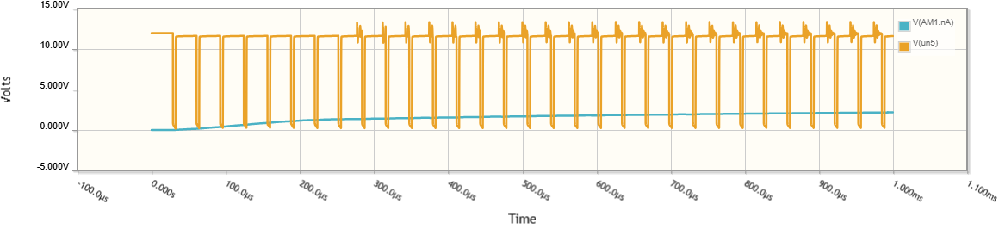
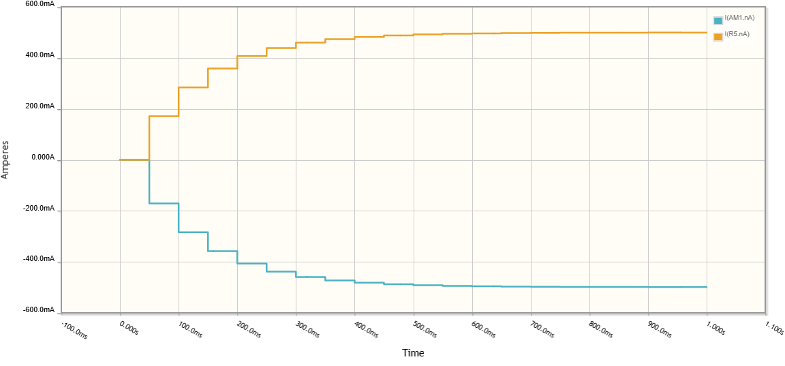

# EE1111A — Solar MPPT, Li-ion Battery Management and Dual-LDR Solar Tracking

## Contents

1. [Project overview](#1-project-overview)
2. [Architecture and signal map](#2-architecture-and-signal-map)
3. [Hardware and component selection](#3-hardware-and-component-selection)
4. [Buck converter: design and operating modes](#4-buck-converter-design-and-operating-modes)
5. [PWM and timer architecture](#5-pwm-and-timer-architecture)
6. [PV sensing and P&O MPPT](#6-pv-sensing-and-po-mppt)
7. [Battery management and protection](#7-battery-management-and-protection)
8. [Electronic programmable load](#8-electronic-programmable-load)
9. [Dual-LDR solar tracking](#9-dual-ldr-solar-tracking)
10. [Serial telemetry and Python dashboard](#10-serial-telemetry-and-python-dashboard)
11. [Experimental validation and tuning history](#11-experimental-validation-and-tuning-history)
12. [Known limitations and further work](#12-known-limitations-and-further-work)
13. [Schematics and simulations](#13-schematics-and-simulations)
14. [References](#14-references)

## 1. Project overview

The project investigates whether a small nominal **12 V, 5 W** solar panel can provide useful energy indoors under a solar lamp, how much power a controllable buck converter can extract, and how that power interacts with a Li-ion cell and a variable electronic load. A two-LDR tracking assembly points the panel toward a directional light source.

The principal control functions are:

- **MPPT:** perturb the buck duty command and observe the change in measured PV input power.
- **Battery management:** prioritize protection limits, implement precharge/current limiting and voltage-based charging termination, and inhibit the electronic load at low battery voltage.
- **Programmable load:** command a MOSFET-based constant-current sink for repeatable loading tests.
- **Tracking:** normalize mismatched LDR responses, reject noise and drive a servo toward the brighter direction.
- **Monitoring:** transmit measured quantities and operating modes over USB serial to a Python dashboard.

## 2. Architecture and signal map

```text
  Nominal 12 V / 5 W PV panel
             |
       INA219 #1 (0x40)
             |
       Input blocking diode
             |
   IRF9530 high-side P-MOSFET <--- Q6 inverter + 2N2222/PN2907A driver <--- D9 PWM
             |
      Switching node ---- freewheel Schottky diode to ground
             |
          1 mH L
             |
       Output capacitor ---- DC output / shared power bus
             |                        |
     Battery/protection path     IRLZ44N electronic load
             |                        ^
       INA219 #2 (0x41)          LM358 current feedback <--- D10 PWM reference
             |                        |
        1S Li-ion cell          0.5 ohm shunt ---> A1 (diagnostic ADC)

  LDR-left divider ---> A2    LDR-right divider ---> A3
                                           Arduino Uno
                                  D11 ---> servo signal (Timer2)
                                  USB ---> Python dashboard
```

| Signal | Arduino Uno | Function |
|---|---|---|
| Buck PWM | D9 / OC1A | Timer1 hardware PWM to gate-driver input |
| Load PWM | D10 / OC1B | Timer1 hardware PWM to electronic-load reference circuit |
| Servo | D11 / PB3 | Timer2 interrupt-scheduled position pulses |
| Load shunt sense | A1 | Diagnostic shunt-voltage reading |
| Left LDR | A2 | Light-dependent divider voltage |
| Right LDR | A3 | Light-dependent divider voltage |
| PV INA219 | I²C, address `0x40` | PV bus voltage and shunt current |
| Battery INA219 | I²C, address `0x41` | Battery-side voltage and signed current |
| USB | Serial, 115200 baud | Commands, telemetry and MPPT debug |

## 3. Hardware and component selection

| Component / parameter | Implemented choice | Rationale and caveat |
|---|---|---|
| Solar panel | Nominal 12 V, 5 W |  |
| Controller | Arduino Uno / ATmega328P | |
| Buck switch | IRF9530 P-channel MOSFET | High-side arrangement simplifies the power-stage concept; its gate must be driven relative to its **source**, not merely relative to ground. |
| Gate driver | Q6 2N2222 inverter, 2N2222/PN2907A push-pull pair | Translates a 5 V logic command toward a higher-voltage gate drive. |
| Buck inductor | **1 mH** | Reduces ripple at low power, but does **not** guarantee CCM at light load. |
| Buck output capacitor | **47 µF** in bench configuration | Buffers switching ripple and transients. |
| Schottky | |
| Load MOSFET | IRLZ44N | Logic-level power MOSFET used as a controlled current sink. |
| Load amplifier | LM358 | Compares filtered current reference with shunt voltage; input offset and output swing. |
| Load shunt | **0.5 Ω** | Very small ADC signal. |
| Battery | Single-cell Li-ion, nominal 3.6–3.7 V |  |
| Battery protection | DW01A + FS8205A  | |
| Current/voltage monitoring | Two INA219 modules | Separates PV-side measurements from battery-side measurements. |
| Tracking | Two LDR dividers + positional servo | Simple differential light sensing with a vertical shadow divider. |


## 4. Buck converter: design and operating modes

### 4.1 Ideal conversion relationship

For an ideal buck converter in continuous-conduction mode (CCM):

\[
V_{out} \approx D V_{in}, \qquad D=\frac{t_{ON}}{T_s}
\]

For example, with `OCR1A = 81`, 8-bit PWM and 13.3 V input:

\[
D \approx \frac{81}{255}=0.3176, \quad V_{out,ideal}\approx4.22\ \mathrm V.
\]

### 4.2 Inductor ripple and CCM/DCM boundary

For an ideal buck in CCM:

\[
\Delta I_L \approx \frac{(V_{in}-V_{out})D}{L f_s}
\]

and the boundary is approximately

\[
I_{L,avg,critical}=\frac{\Delta I_L}{2}.
\]

With **12 V in, 3.81 V out, 31.37 kHz, 1 mH, D = 0.318**:

\[
\Delta I_L \approx 83\ \mathrm{mA},\qquad I_{critical}\approx41.5\ \mathrm{mA}.
\]

For a resistive load, the familiar equivalent is:

\[
L_{critical}=\frac{(1-D)R}{2 f_s}.
\]

| Equivalent output load | Approx. critical inductance (D = 0.318) | Implication for 1 mH |
|---|---:|---|
| 84 Ω (4.2 V / 50 mA) | 0.91 mH | Near CCM boundary |

If the battery supplies most of the load, the **buck inductor current** can remain low even when electronic-load demand is high. 

### 4.3 Input and output power

\[
P_{PV}=V_{PV}I_{PV},\quad P_{out}=V_{out}I_{buck,out},\quad
\eta_{converter}=\frac{P_{out}}{P_{PV}}\times100\%.
\]

When a battery and load share the bus and all relevant branches are measured with consistent polarity:

\[
I_{buck,out}\approx I_{load}+I_{battery,charge}+I_{aux}.
\]

## 5. PWM and timer architecture

### 5.1 Why 31.37 kHz?

Timer1 is configured for **8-bit phase-correct PWM**, prescaler `N = 1`, TOP = 255. With a 16 MHz ATmega328P clock:

\[
f_{PWM}=\frac{16\,000\,000}{2\times1\times255}
=31\,372.5\ \mathrm{Hz}.
\]

The frequency is above the most audible switching range, allows compact passive components, and gives 256 command levels. Timer1 channel A drives **D9** and channel B drives **D10**.

The PWM compare register uses **0–255**, even though the controller limits the buck command to `MAX_BUCK_DUTY = 160`:

\[
D_{actual}\approx\frac{\texttt{buckDuty}}{255},\qquad
D_{max}\approx\frac{160}{255}=62.75\%.
\]

### 5.2 Why Timer2 for the servo?

An initial integrated version generated 1–2 ms servo pulses from `micros()` in the main loop. I²C reads and other processing could delay the falling edge and make the servo jitter **even with `TRACK OFF`**.

The integrated revision uses **Timer2 compare interrupts**, prescaler 64, giving a **4 µs tick**. It schedules a nominal 20 ms frame (5,000 ticks) and a 1,000–2,000 µs HIGH pulse (250–500 ticks), with D11 controlled directly through PB3. The 8-bit timer divides long intervals into chunks.

## 6. PV sensing and P&O MPPT

### 6.1 PV measurement

The PV INA219 is at I²C address **0x40**. The firmware reads its shunt voltage and bus voltage and reconstructs the input-side voltage.

### 6.2 Perturb-and-observe principle

The converter changes its duty by one PWM count and measures the resulting PV power. If power increases, it continues in the same direction; if power decreases meaningfully, it reverses. The basic P&O rule is:

\[
\Delta P=P_k-P_{k-1};\qquad
\text{reverse direction when }\Delta P< -\epsilon.
\]

In this implementation, perturbation is in **duty**, not directly in PV voltage. Because duty and PV operating voltage can move in opposite directions, the sign of `mpptDirection` is defined in PWM-count space.

### 6.3 Evolution of the controller

| Revision | Behavior observed | Engineering response |
|---|---|---|
| Initial P&O | A fixed **10 mW** power-drop test could ignore small changes and sometimes linger at low duty. | Add debug output for average power, previous power, `dP`, direction and duty. |
| Adaptive experiment | **3 mW** minimum deadband and 5-sample averaging caused premature reversals near low-power/noisy operation. | Increase noise rejection. |
| Current noise-resistant implementation | **10 fresh sensor samples** per duty decision, **10 mW or 2%** deadband, and **two confirmed significant drops** before reversing. | Slower but more stable search under the lamp. |

Current code constants:

```cpp
const byte MPPT_SETTLE_TICKS = 10;
const float MPPT_MIN_DEADBAND_W = 0.010f;
const float MPPT_REL_DEADBAND = 0.02f;
```

With `SENSOR_PERIOD = 100 ms`, the controller makes approximately **one duty perturbation per second**. The effective deadband is:

\[
\epsilon=\max(0.010\ \mathrm W,\;0.02P_{previous}).
\]

At 0.30 W, 2% is 6 mW, so the 10 mW floor dominates. At 0.70 W, 2% is 14 mW and the relative threshold dominates.

The current reversal logic increments `mpptDropCount` for a drop larger than the deadband, resets it for an increase larger than the deadband, and retains it for changes inside the deadband. At two qualifying drops, it reverses. 

**Known limitation:** many successive small negative changes can cumulatively move the operating point away from the peak without triggering reversal. A rolling power baseline or duty sweep would improve convergence.

### 6.4 Evidence from diagnostics

At one observed charging interval, increasing duty from **51 to 67** raised PV power from approximately **0.218 W to 0.290 W** and the reported battery current from **+23 mA to +37 mA**. The MPPT log showed small negative `dP` events correctly ignored rather than causing immediate reversals. At a later interval near duty **87–96**, PV power declined from approximately **0.574 W to 0.513 W** while the controller continued increasing duty: this exposed the cumulative-small-decrease limitation above.

These logs support improved **noise resistance**, but do not independently establish global maximum-power tracking or guarantee charging-current accuracy.

## 7. Battery management and protection

### 7.1 Battery measurements and current sign

The battery INA219 uses address **0x41**. The implemented convention is **positive = charging**, **negative = discharging**:

```cpp
float bShunt = battery.getShuntVoltage_mV();
float bV = battery.getBusVoltage_V() + bShunt / 1000.0f;
float bI = -bShunt / 100.0f;
```

The negative sign is a software convention and is only correct if the module is physically oriented as assumed. The laboratory discussion identified a recurring **−4 mA resting reading**. A proposed `+0.004 A` correction should only be enabled after confirming the true branch current is zero; otherwise it would conceal genuine standby discharge. **The inspected noise-resistant controller file does not yet include this offset.**

### 7.2 Implemented limits

| Parameter | Firmware setting | Intended behavior / justification |
|---|---:|---|
| `PRECHARGE_BELOW` | **3.00 V** | Switch to a reduced current limit at low cell voltage. |
| `PRECHARGE_LIMIT` | **50 mA** | Lower-current recovery region; cell-specific suitability must be verified. |
| `CHARGE_LIMIT` | **300 mA** | Normal software charging-current ceiling; 300 mA is a selected design limit, not derived from a supplied cell datasheet. |
| `CV_TARGET` | **4.15 V** | Conservative target below the common 4.20 V full-charge voltage for many 1S Li-ion cells; verify the actual cell chemistry/specification. |
| `OVERVOLT_TRIP` | **4.19 V** | Software overvoltage fault threshold. |
| `OVERCURRENT_TRIP` | **360 mA** | Overcurrent trip above nominal 300 mA limit. |
| `TERMINATE_BELOW` | **45 mA** | Low-current termination criterion when near CV target. |
| `TERMINATION_HOLD` | **30 s** | Require low charging current to persist before declaring FULL. |
| `CHARGE_TIMEOUT` | **12 h** | Maximum accumulated PWM-enabled charging time. |
| `LOAD_CUTOFF` | **3.20 V** | Disable electronic load at low battery voltage. |
| `LOAD_RESTART` | **3.45 V** | Hysteretic load re-enable point to prevent immediate chatter. |
| `PV_HEADROOM` | **0.7 V** | Minimum requested PV-over-battery voltage margin. |
| PV enable/disable | **7.0 V / 6.5 V** | Hysteresis for declaring sufficient PV voltage. |
| Retry delay | **3 s** | Wait after charge-overcurrent event. |
| Trip window | **60 s** | Repeated events can latch a fault. |
| Stale-data limit | **2 s** | Detect loss of valid sensor updates. |
| Watchdog | **1 s** | Restart a stalled MCU; not a substitute for independent power-stage protection. |

### 7.3 Charging-state precedence

```text
FAULT / disabled / FULL  -> buck OFF
         |
   battery overvoltage / overcurrent / timeout -> shutdown or retry
         |
   insufficient PV voltage -> NO_SUN, buck OFF
         |
   near 4.15 V -> CV (reduce duty if voltage/current too high)
         |
   near current ceiling -> CC_LIMIT (reduce/hold duty)
         |
   otherwise -> MPPT (P&O duty search)
```

The firmware uses 25 mA current hysteresis and 15 mV CV hysteresis to avoid excessive mode changes. A 30 s hold near the CV target and below 45 mA marks `FULL`. A `REARM` command is retained in firmware for manually clearing the full state when the battery has fallen to or below 4.00 V; it need not appear prominently on the presentation dashboard.

### 7.4 Battery power sharing

When battery and load are on the same output bus, the current balance is approximately:

\[
I_{buck,out}=I_{load}+I_{battery,charge}+I_{aux}.
\]

For example, if the load draws 100 mA and the buck contributes 30 mA, the battery supplies approximately 70 mA (negative charge current). Conversely, when the load is turned off, more available buck output can charge the cell.

## 8. Electronic programmable load

### 8.1 Closed-loop current sink

The IRLZ44N dissipates the electrical power drawn from the output bus. The LM358 compares a filtered D10 PWM reference against the shunt-sense voltage and adjusts MOSFET gate drive to regulate current. For a 0.5 Ω shunt:

\[
I_{load}=\frac{V_{shunt}}{0.5\ \Omega},\qquad
V_{shunt}=0.5\ I_{load}.
\]

| Target | Expected shunt voltage | Shunt dissipation |
|---|---:|---:|
| 10 mA | 5 mV | 0.05 mW |
| 50 mA | 25 mV | 1.25 mW |
| 100 mA | 50 mV | 5 mW |
| 200 mA | 100 mV | 20 mW |
| 300 mA | 150 mV | 45 mW |
| 500 mA | 250 mV | 125 mW |

The load's **MOSFET**, not the shunt, may dissipate most of the power. Approximate MOSFET dissipation is `P ≈ (Vbus − Vshunt) × Iload`; 

### 8.2 PWM reference calibration

The firmware maps commanded amperes to D10 compare counts:

```cpp
byte duty = constrain((int)(amps * 510.0f + 0.5f), 1, 255);
```

Thus a requested 50 mA corresponds to approximately 26 counts, 100 mA to 51, 200 mA to 102, and 500 mA to 255.

## 9. Dual-LDR solar tracking

### 9.1 Two-point calibration

Two LDR voltage dividers are sampled on A2 and A3. Their raw outputs differed substantially under equal illumination, causing the servo to bias toward one side. Two equal-illumination calibration conditions were recorded:

| Calibration condition | Left ADC | Right ADC |
|---|---:|---:|
| Higher illumination | **664** | **497** |
| Lower illumination | **21** | **10** |

The firmware uses an affine correction for the right sensor:

\[
G=\frac{L_{lamp}-L_{room}}{R_{lamp}-R_{room}}
=\frac{21-664}{10-497}\approx1.3203,
\]

\[
R_{corrected}=L_{room}+(R_{raw}-R_{room})G.
\]

With the code's actual labels:

```cpp
const float LEFT_ROOM=664.0f, RIGHT_ROOM=497.0f;
const float LEFT_LAMP=21.0f, RIGHT_LAMP=10.0f;
```
### 9.2 Filtering and hysteresis

The tracker samples approximately every **30 ms** and uses exponential smoothing:

\[
L_f[k]=0.6L_f[k-1]+0.4L_{raw}[k],\quad
R_f[k]=0.6R_f[k-1]+0.4R_{raw}[k].
\]

The signed error is `e = round(L_filtered − R_corrected)`; tracking starts when `|e| > 12` and stops when `|e| < 6`. This **12/6 hysteresis** was chosen after resting differences were observed below roughly 10 counts. It avoids a single noisy sample toggling the servo repeatedly while remaining responsive to a directional torch/lamp.

### 9.3 Adaptive movement

| Absolute corrected error | Step per movement command |
|---|---:|
| 0–6 | Stop once hysteresis condition is met |
| >6 up to 50 while tracking | 2° |
| >50 up to 150 | 5° |
| >150 | 8° |

The servo target is updated no more frequently than **every 50 ms**, so the maximum **commanded** rate is `8° / 0.05 s = 160°/s`; physical motion depends on the servo's speed and load. The controller constrains angles to **20°–150°** because buzzing was observed near the original 170° endpoint. A vertical divider between LDRs provides directional shading. Reaching a software limit stops further target increments, but a positional servo still applies holding torque and can buzz at a physical stop.

## 10. Serial telemetry and Python dashboard

The controller emits **12 CSV fields** at approximately **1 Hz**, with `#`-prefixed diagnostics and status messages:

```csv
ms,pvV,pvA,pvW,batV,chargeA,loadA,targetA,buckDuty,servo,mode,fault
```

| Field | Unit / meaning |
|---|---|
| `ms` | Arduino uptime, milliseconds |
| `pvV`, `pvA`, `pvW` | Measured PV voltage, signed current and calculated power |
| `batV`, `chargeA` | Battery-side voltage and signed current (positive means charge **if polarity verified**) |
| `loadA` | A1-derived load-current estimate |
| `targetA` | Commanded load current, amperes |
| `buckDuty` | Timer1 compare count, **0–160** software range, **0–255** PWM scale |
| `servo` | Commanded angle, degrees |
| `mode` | `OFF`, `NO_SUN`, `MPPT`, `CC_LIMIT`, `CV`, `FULL`, `OC_RETRY`, `FAULT`, etc. |
| `fault` | Fault flag, 0 or 1 |

Example commands:

```text
CHARGE ON
CHARGE OFF
LOAD 50
LOAD 100
LOAD OFF
TRACK ON
TRACK OFF
ANGLE 90
STATUS
RESETFAULT
REARM
```

The Python dashboard (`PySide6`, `pyserial`, `pyqtgraph`) provides serial-port connection, live PV/battery cards, load slider, tracker controls, current and power graphs, and controller messages. The later dashboard revision auto-scales graph axes and places the current legend above the plot.

Install and run locally:

```bash
python -m pip install PySide6 pyserial pyqtgraph
python Dashboard_Autoscale_Legend.py
```

## 11. Known limitations and further work

1. **Charging safety:** Replace experimental open-loop / software-only protection assumptions with a verified dedicated single-cell CC/CV charging stage and independent protection. Verify battery temperature, voltage, current, MOSFET OFF state and fault response before unattended operation.
2. **MPPT convergence:** Replace the two-drop heuristic with a rolling baseline or bounded sweep/reacquisition strategy; benchmark against a measured PV I–V/P–V curve under constant illumination.
3. **Load measurement:** Add differential/Kelvin shunt sensing or a calibrated amplifier

## 13. Schematics and simulations

### DC–DC converter simulation

[CircuitLab — DC–DC converter](https://www.circuitlab.com/circuit/5bz5z3zyunb5/dc-dc/)



### Electronic programmable load simulation

[CircuitLab — Electronic programmable load](https://www.circuitlab.com/circuit/7zh994n8n9vx/electronic-programmable-load/)



### Full project schematic

[View project schematic (PDF)](schematic/EE1111A.pdf)
